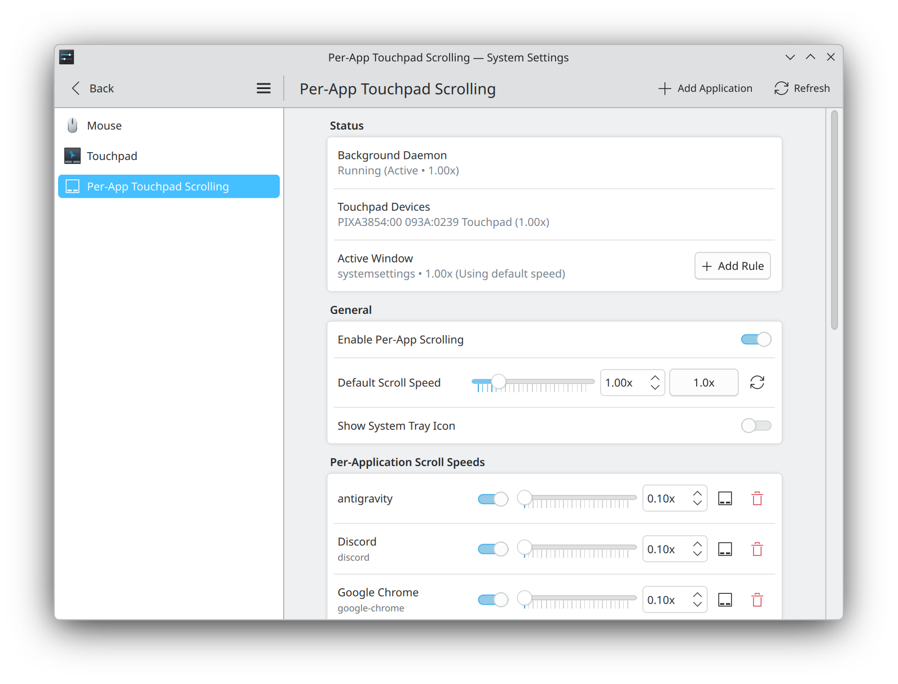

# KDE Per-App Touchpad Scrolling

Configure touchpad scroll speed (`scrollFactor`) on a per-application (and per-window-title) basis in **KDE Plasma 6 (Wayland)** directly from **System Settings**.



## Architecture

1. **KWin Script (`kwin-script/`)**: Listens for `workspace.windowActivated` and `captionChanged` events in KWin and sends the focused window's `resourceClass`, `resourceName`, `desktopFileName`, and `caption` to the daemon via `callDBus`.
2. **Background Daemon (`kde-per-app-scrolling-daemon`)**: Receives window-focus notifications on `io.github.kdeperappscrolling.Daemon`, matches the active window against your rules in `~/.config/kde-per-app-scrolling/config.json`, and updates `scrollFactor` on all KWin libinput touchpad devices (`/org/kde/KWin/InputDevice/<sysName>`). Also provides an optional native KDE system tray icon (`org.kde.StatusNotifierItem` + `com.canonical.dbusmenu`).
3. **KDE System Settings Module (`kcm/`)**: Native C++ / Qt6 / Kirigami `KQuickConfigModule` (`kcm_per_app_scrolling`) appearing under **System Settings -> Input & Output -> Mouse & Touchpad -> Per-App Touchpad Scrolling**.

## Requirements

- Runtime (pre-installed on Fedora KDE Plasma 6):
  - `python3`, `python3-dbus`, `python3-gobject-base`
  - `kf6-kirigami`, `kf6-kirigami-addons`, `kwin`
  - `kpackagetool6`, `kwriteconfig6`, `qdbus-qt6`
- Build dependencies for the KDE System Settings KCM plugin (Fedora):
  ```bash
  sudo dnf install cmake gcc-c++ extra-cmake-modules qt6-qtbase-devel qt6-qtdeclarative-devel kf6-kcmutils-devel kf6-kcoreaddons-devel kf6-ki18n-devel
  ```

## Installation

1. Build and install the KDE System Settings KCM plugin:
   ```bash
   ./kcm/install-kcm.sh
   ```
2. Install and start the daemon and KWin script:
   ```bash
   ./install.sh
   ```

## Usage

- Open **System Settings -> Input & Output -> Mouse & Touchpad -> Per-App Touchpad Scrolling**, or run:
  ```bash
  systemsettings kcm_per_app_scrolling
  ```
- Click **Add Application** in the toolbar to pick an installed or recently focused application (or enter a custom `resourceClass` / `.desktop` name and optional **Title Contains** filter for web apps or browser tabs).
- Adjust the speed slider/spinbox for each app (`1.00x` is Plasma's default; `< 1.0` slows scrolling, `> 1.0` speeds it up) and feel the speed live in the **Scroll Test Pad**.
- Left-click the tray icon to open System Settings, middle-click (`SecondaryActivate`) to pause/resume, or right-click for quick actions.

## RPM Packaging & GitHub Actions

A Fedora RPM spec and local build helper live under `packaging/rpm/`:

```bash
sudo dnf install rpm-build
./packaging/rpm/build-local-rpm.sh
```

After installing a built `.rpm` (`sudo dnf install ./rpmbuild/RPMS/x86_64/kde-per-app-scrolling-*.rpm`), enable the KWin script and start the user service in your Plasma session:

```bash
kwriteconfig6 --file kwinrc --group Plugins --key kde-per-app-scrollingEnabled true
qdbus-qt6 org.kde.KWin /KWin reconfigure
systemctl --user enable --now kde-per-app-scrolling.service
```

The GitHub Actions workflow in [.github/workflows/build-rpm.yml](.github/workflows/build-rpm.yml) builds and tests RPMs on Fedora `latest` and `rawhide` on pushes/PRs, and automatically attaches the `latest` RPM and SRPM to a GitHub Release when pushing a `v*` tag (e.g., `git tag v0.1.0 && git push origin v0.1.0`).

## Troubleshooting

- **Check daemon logs:**
  ```bash
  journalctl --user -u kde-per-app-scrolling.service -f
  ```
- **Check KWin script logs:**
  ```bash
  journalctl --user -u plasma-kwin_wayland -f
  ```
- **Verify KWin touchpad devices via D-Bus:**
  ```bash
  qdbus-qt6 org.kde.KWin /org/kde/KWin/InputDevice
  ```

## Uninstall

```bash
./uninstall.sh
./kcm/uninstall-kcm.sh
```

Your saved rules in `~/.config/kde-per-app-scrolling/config.json` are preserved.
